<!-- README from framework/templates/README-template.md -->

# 🚀 Flask Auth (Day 68)

A walkthrough of Day 68 of Udemy's "100 Days of Code: The Complete Python Pro Bootcamp": user authentication in Flask. It is written for course participants who want to compare solutions and for visitors looking for ideas. This repository holds a working Flask application that implements the lecture steps, with pytest tests, plus the documentation and wiki that explain them.

## 📚 Table of Contents

- [Overview](#-overview)
- [Requirements](#-requirements)
- [Setup](#-setup)
- [Run](#-run)
- [Tests](#-tests)
- [License](#-license)
- [Links](#-links)
- [Appendix: Project documents](#-appendix-project-documents)

## 🧭 Overview

The lecture builds a small Flask site where people register, log in, see a secret page and download a file. The screenshots below come from the lecture's end project, run in a Docker container with test data only.

| Folder | Purpose |
| --- | --- |
| `src/flask_auth/` | The Flask application in four layers: `domain`, `application`, `infrastructure`, `presentation`, with `bootstrap.py` as composition root |
| `tests/` | pytest tests in `unit/`, `integration/` and `e2e/` |
| `docs/` | Project documents, the step screenshots (`docs/images/`) and the wiki (`docs/wiki/`) |

The [wiki][wiki] explains what each lecture step taught, in English, Danish and Bahasa Malaysia.

### Lecture steps

#### 1. Register new users and greet them

The `/register` form takes a name, an email and a password, creates a `User` and saves it in `users.db`. The user is then sent straight to `secrets.html`, whose `h1` greets them by name.

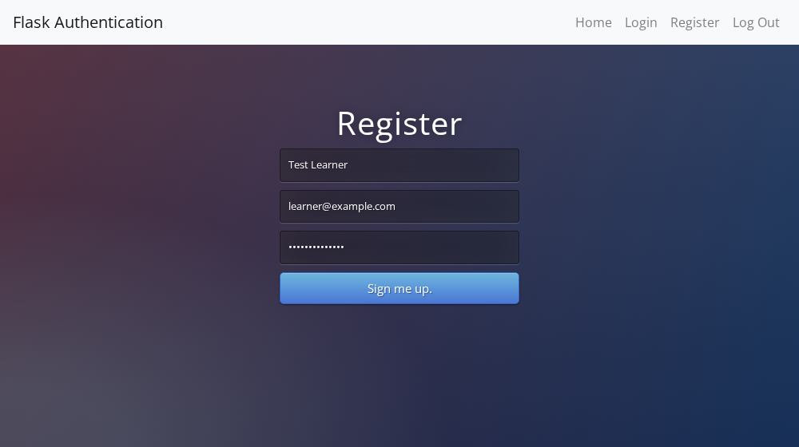


#### 2. Download a file

The "Download Your File" link calls `GET /download`, which uses Flask's `send_from_directory()` to return `static/files/cheat_sheet.pdf`.


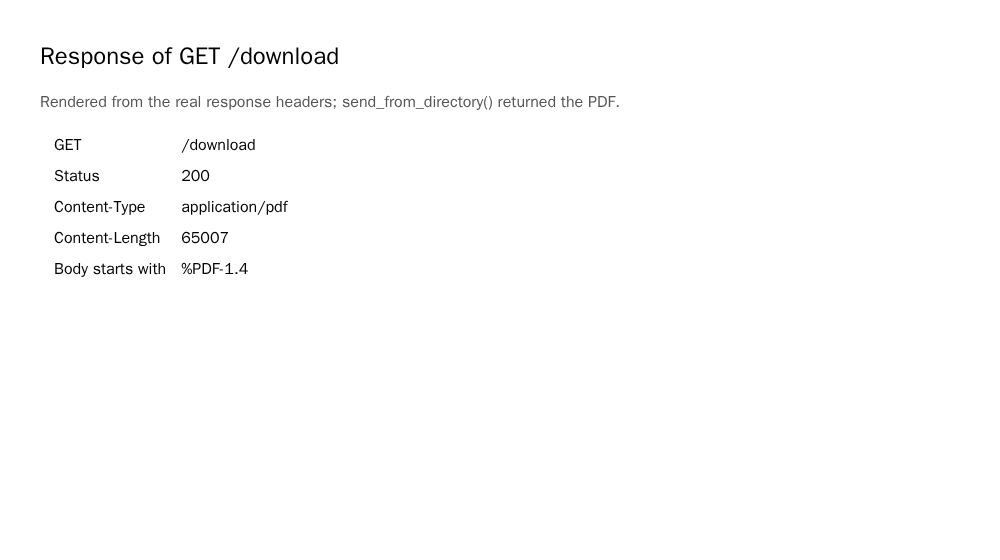

#### 3. Encryption, hashing and password attacks (theory)

Plain text storage is unsafe. Encryption needs a key and can be reversed with it; a hash is one way. Hackers use hash tables and dictionary attacks against common passwords, so a long, complex password and a salt matter. The illustration shows the same password hashing to the same value, and two salted hashes that differ.

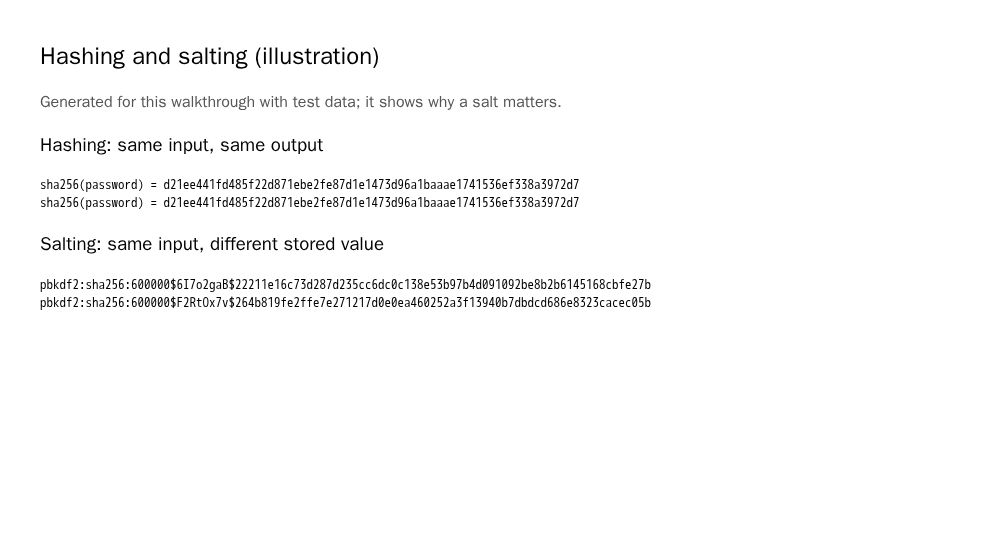

#### 4. Hash and salt passwords with Werkzeug

`generate_password_hash()` with `method="pbkdf2:sha256"` and `salt_length=8` hashes and salts the password before it is stored. The database never holds the password itself.

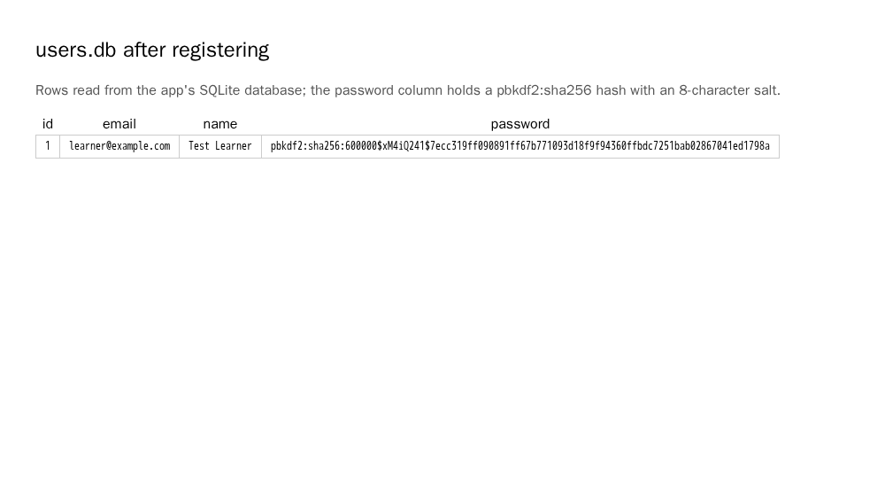

#### 5. Authenticate users with Flask-Login

Flask-Login needs a `LoginManager`, a `user_loader` callback and a `User` that uses `UserMixin`. `login_user()` logs a user in after registering or logging in, `@login_required` protects `/secrets` and `/download`, and `check_password_hash()` verifies the password. `/logout` ends the session; in this repository it accepts POST only (see Run).

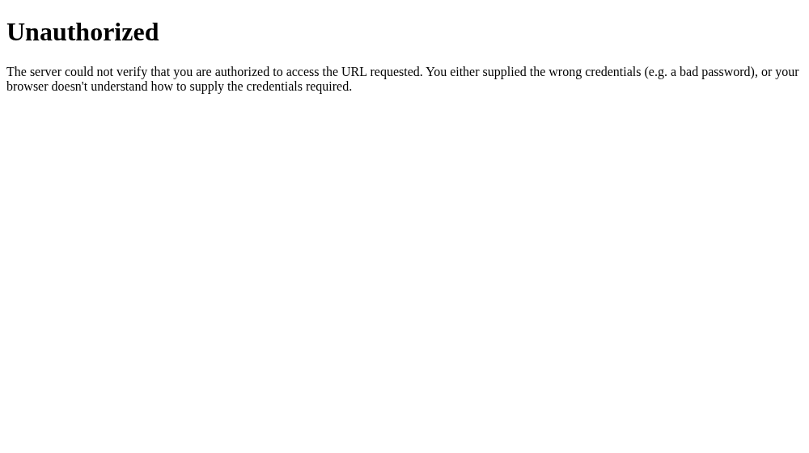
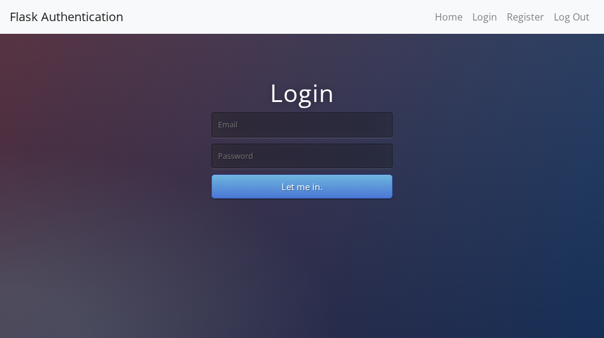
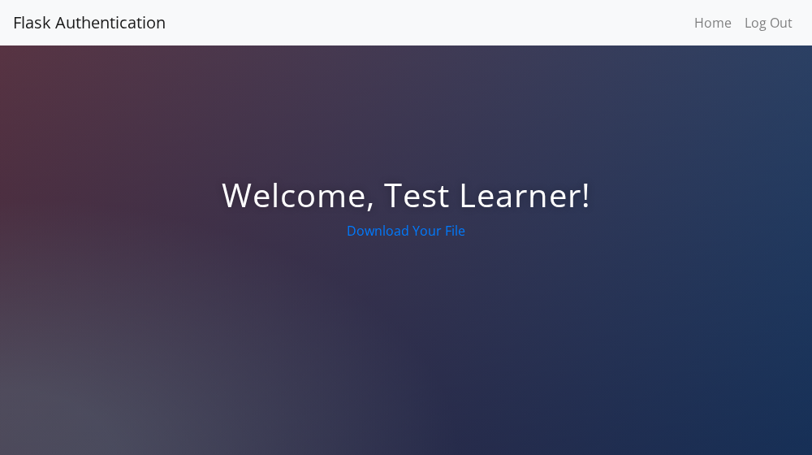

#### 6. Flash messages

`flash()` gives feedback once: the email does not exist, the password is wrong, or the email is already registered. The login template shows each message in a `<p>` tag.


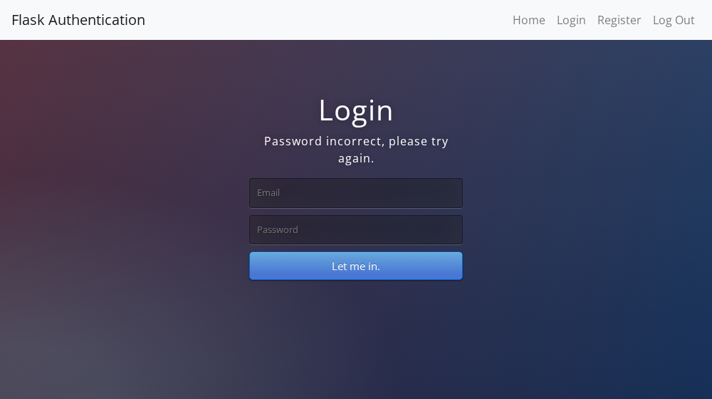
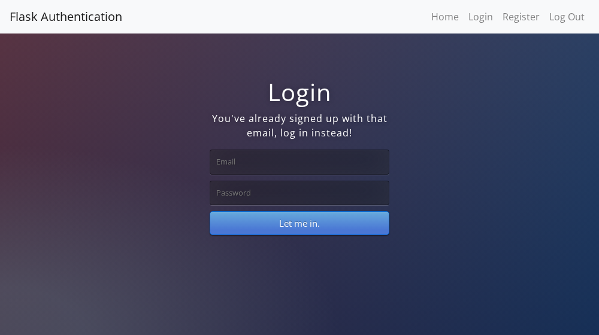

#### 7. Pass the authentication status to templates

Routes pass `logged_in=current_user.is_authenticated` to the templates. `base.html` and `index.html` hide Login and Register for a logged-in user, and the home page adds "(you are already logged in)".

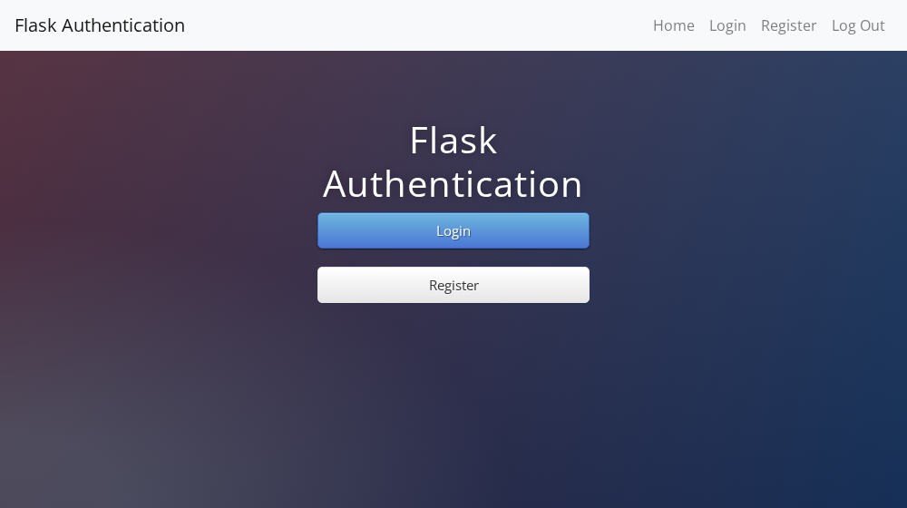
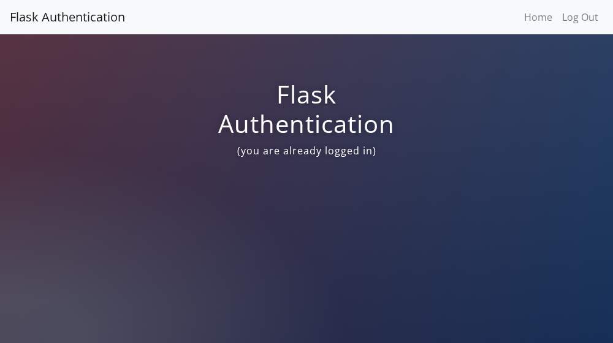

## 📋 Requirements

- Python 3.13 or newer.
- `venv`, to keep the project's packages apart from the system Python.
- The packages declared in `pyproject.toml` (Flask, Flask-Login, Flask-SQLAlchemy, SQLAlchemy, Werkzeug); pytest for the tests.
- Doxygen, only to generate documentation of the source code (`Doxyfile`).

## 🛠️ Setup

Create and use a local `.venv`, then upgrade `pip`:

```bash
python -m venv .venv
source .venv/bin/activate        # Linux and macOS
.venv\Scripts\activate           # Windows (PowerShell or cmd)
python -m pip install --upgrade pip
python -m pip install -e ".[dev]"
```

Packages are installed from `pyproject.toml`. On Python 3.13 `SQLAlchemy>=2.0.36` is required, because `2.0.25` fails to import.

## ▶️ Run

The application has no default secret key. Set `SECRET_KEY` in the environment, then start the development server from the activated `.venv`:

```bash
export SECRET_KEY="$(python -c 'import secrets; print(secrets.token_hex(32))')"   # Linux and macOS
python -m flask_auth
```

On Windows PowerShell set the variable with `$env:SECRET_KEY = "..."`. The server serves `http://127.0.0.1:5000` and creates `instance/users.db` on first start; set `DATABASE_URI` to use another database. Debug mode is off unless `FLASK_AUTH_DEBUG=1`.

The register and login forms are protected against cross-site request forgery (CSRF) with Flask-WTF: each form carries a hidden `csrf_token` field, and a POST without a valid token is answered with 400. Logging out is a POST as well: the navbar "Log Out" entry is a small form with a token, and `GET /logout` returns 405. This departs from the lecture, where logout is a plain link, because a GET that changes state can be triggered from another site.

The pages are styled with Bootstrap 5.3.3, loaded from the jsDelivr CDN with pinned versions and SRI hashes, plus an own stylesheet in `src/flask_auth/presentation/static/css/app.css` that gives them the look of the screenshots above (dark gradient background, centred column, gradient buttons). The Bootstrap files need network access; the font is Open Sans when installed and a system sans-serif otherwise, since no font service is used. Only the `css/` folder is served as static files; the download in `static/files/` stays behind the login.

## 🧪 Tests

```bash
python -m pytest
```

The tests use an in-memory SQLite database; nothing is written to disk.

## 📄 License

GNU Affero General Public License v3.0, see [LICENSE](LICENSE).

## 🔗 Links

- [Repository][repository]
- [Documentation][documentation]
- [Issue tracker][issues]

## 📎 Appendix: Project documents

The documents a newcomer needs, in reading order.

| Document | What it tells you |
| --- | --- |
| [AGENTS.md][agents] | The rules AI agents follow in this repository |
| [Business Case][BC-001] | Why the project exists, its scope and success criteria |
| [Stakeholder Analysis][SA-001] | Who is involved; the stakeholder IDs used for owners and reviewers |
| [Project Plan][PP-001] | The gateways and their schedule |
| [Milestones][milestones] | One document per gateway: Go/No-Go criteria and tasks |
| [Artifact registry][registry] | Where each artifact type lives, the next version, the PO language and domain |
| [Traceability matrix][TM-001] | How the artifacts link and when each was last reviewed |
| [Framework README][framework-readme] | The framework this project uses |
| [Framework changelog][framework-changelog] | What changed in each framework release |

---

[repository]: https://git.tirsystem.com/Tirsvad-Udemy-100-days-of-code/068-flask-auth
[wiki]: https://git.tirsystem.com/Tirsvad-Udemy-100-days-of-code/068-flask-auth/wiki
[documentation]: https://git.tirsystem.com/Tirsvad-Udemy-100-days-of-code/068-flask-auth/wiki
[issues]: https://git.tirsystem.com/Tirsvad-Udemy-100-days-of-code/068-flask-auth/issues
[agents]: ./AGENTS.md
[BC-001]: ./docs/business-case.md
[SA-001]: ./docs/stakeholder-analysis.md
[PP-001]: ./docs/project-plan.md
[milestones]: ./docs/milestones/
[registry]: ./docs/artifact-registry.md
[TM-001]: ./docs/sqa/traceability-matrix.md
[framework-readme]: ./framework/README.md
[framework-changelog]: ./framework/CHANGELOG.md
