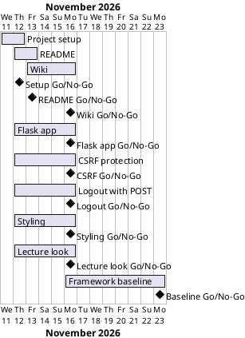

# Project Plan

## Metadata
| Key | Value |
| --- | --- |
| ID | PP-001 |
| CrossReference | [BC-001], [SA-001], [MIL-001], [MIL-002], [MIL-003], [MIL-004], [MIL-005], [MIL-006], [MIL-007], [MIL-008], [MIL-009] |
| Language | en |
| Domain | education |

## Version History
| Date | Status | Author | Reviewer | Change | Commit |
| --- | --- | --- | --- | --- | --- |
| 2026-11-11 | Deprecated | Jens Tirsvad Nielsen | S01 | Add MIL-007 styling with Bootstrap<br>Reviewed in RC-024: Go | [7bcae68] |
| 2026-11-11 | Deprecated | Jens Tirsvad Nielsen | S01 | Add MIL-008 lecture look<br>Reviewed in RC-027: Go | [6bd7fad] |
| 2026-11-16 | Accepted | Jens Tirsvad Nielsen | AI as stand-in for S01 | Added the baseline gateway MIL-009 with its schedule row, scope coverage, dependency, risk and Gantt entries; recorded the move of the end date, the domain, the open pull request #53, the prompt log, the traceability matrix and the CI in the Planning Assumptions and Open Issues; replaced the milestone column of the gateways that said `not yet synced` or only `(closed)` with links to their milestones on the git host; updated the Purpose; set the domain to education; reviewed in autonomous mode, not independent<br>Reviewed in RC-030: Go | pending |

---

## Purpose

Schedule the gateways that turn the Day 68 lecture into a README, a three-language wiki and a working Flask application, and that bring the finished project to the baseline of the framework ([MIL-009]). The end date is set by the Business Case constraint (see the Planning Assumptions). [MIL-001] to [MIL-003] are documentation only, [MIL-004] to [MIL-008] build and style the application, and [MIL-009] changes no behaviour.

## Planning Assumptions

- The plan starts 2026-11-11 and ends by 2026-11-16, the duration constraint in [BC-001] (Constraints).
- The baseline gateway MIL-009 starts 2026-11-16 and ends 2026-11-23, one week (source: [BC-001], Constraints). It brings the finished project to the baseline of the framework, a decision of S01. The decision dates of the eight earlier gateways stay as they were, so the end date of the plan moves from 2026-11-16 to 2026-11-23.
- Each phase is one branch and one pull request that closes its issues (source: the request of S01).
- S01 owns and reviews every phase; in autonomous mode the AI acts as stand-in reviewer and records it (source: AGENTS.md, Modes).
- For MIL-009 S01 has authorised the assistant to commit, push, open the pull request and merge it, and the review is done by an AI stand-in for S01 (source: [BC-001], Constraints and Risks).
- The PO language is English; the domain is IT until [MIL-009] and education since.

## Gateway Schedule

| Gateway | Document | Window | Decision date | Owner | Stories | Main deliverable | Milestone |
| --- | --- | --- | --- | --- | --- | --- | --- |
| Project setup | [MIL-001] | 2026-11-11 to 2026-11-12 | 2026-11-12 | S01 | none (documentation tasks) | Repository metadata and configuration | [Milestone 431][ms-431] |
| README | [MIL-002] | 2026-11-12 to 2026-11-13 | 2026-11-13 | S01 | none (documentation tasks) | README with step screenshots | [Milestone 432][ms-432] |
| Wiki | [MIL-003] | 2026-11-13 to 2026-11-16 | 2026-11-16 | S01 | none (documentation tasks) | Wiki in en, da, ms | [Milestone 433][ms-433] |
| Flask app | [MIL-004] | 2026-11-12 to 2026-11-16 | 2026-11-16 | S01 | none (technical tasks) | Flask application with tests | [Milestone 445][ms-445] |
| CSRF protection | [MIL-005] | 2026-11-12 to 2026-11-16 | 2026-11-16 | S01 | none (technical tasks) | CSRF tokens on the register and login forms | [Milestone 448][ms-448] |
| Logout with POST | [MIL-006] | 2026-11-12 to 2026-11-16 | 2026-11-16 | S01 | none (technical tasks) | POST-only logout with a CSRF-protected form | [Milestone 454][ms-454] |
| Styling | [MIL-007] | 2026-11-12 to 2026-11-16 | 2026-11-16 | S01 | none (technical tasks) | Bootstrap and own CSS on every page | [Milestone 455][ms-455] |
| Lecture look | [MIL-008] | 2026-11-12 to 2026-11-16 | 2026-11-16 | S01 | none (technical tasks) | Pages match the README screenshots | [Milestone 456][ms-456] |
| Framework baseline | [MIL-009] | 2026-11-16 to 2026-11-23 | 2026-11-23 | S01 | none (technical tasks) | Branch `mil-009-framework-baseline` merged: the adopted framework release, the README, project URL and licence metadata, `.editorconfig`, `.env.example`, the traceability matrix and review records | [Milestone 589][ms-589] |



## Scope Coverage

| Business Case scope item | Gateway |
| --- | --- |
| Repository description and topics; `pyproject.toml`, `.gitignore`, `Doxyfile` | [MIL-001] |
| README, screenshots, `.venv` instructions | [MIL-002] |
| Wiki in three languages | [MIL-003] |
| Flask application and tests | [MIL-004] |
| CSRF protection of the forms | [MIL-005] |
| Logout as a protected POST | [MIL-006] |
| Styling of the pages | [MIL-007] |
| Pages match the README screenshots | [MIL-008] |
| The baseline: framework release, README, project URL and licence metadata, editor settings, environment template, traceability matrix, review records (objective 7) | [MIL-009] |
| opengrep scan before push | All gateways |

## Dependencies

```
MIL-001 → MIL-002 → MIL-003
MIL-003 → MIL-004 → MIL-005 → MIL-006 → MIL-007 → MIL-008 → MIL-009
```

A No-Go on a gateway moves every later gateway by the rework time and may move the end date (2026-11-16 until MIL-009, 2026-11-23 since MIL-009); S01 decides any move of the end date.

## Plan Risks

| Risk | Impact | Mitigation |
| --- | --- | --- |
| The signed course archive link has expired (BC-001 risk 1) | Screenshots are blocked | Stop and report per the autonomous stop rules; S01 supplies the archive |
| Docker image build for the end project fails | Screenshots delayed | Fix on the same branch; stop after three failed rounds |
| A continuous integration (CI) check fails on the pull request of [MIL-009] | The merge is delayed past 2026-11-23 | The failure is fixed on the same branch and the checks run again; after three failed rounds on one cause the work stops and S01 decides (trace: success criterion 6 of [BC-001]) |

## Open Issues

- The course archive link in the request carries an expiry; its validity is checked in MIL-002 task 1.
- Domain: since [MIL-009] the plan, the Business Case and the baseline milestone have the domain `education`. The other documents (Stakeholder Analysis, the milestones MIL-001 to MIL-008, ADR-0001 and the review records RC-001 to RC-028) keep the domain `it` they were accepted with; they are not changed by the baseline, and a change of their domain would need a new review of each.
- The git host also has the open pull request #53 (framework submodule URL in lowercase); the baseline delivers the same change in the pull request of MIL-009. The baseline does not close #53 on the host; S01 decides what happens to it after the merge.
- The prompt log `docs/ai-prompts/` is listed in `.gitignore` and not tracked; MIL-009 keeps its own prompt log in a new session folder there and does not change the existing one.
- The project has no workflow file of its own; the pull request of MIL-009 is the first one that the shared CI checks of the git host run on.
- Traceability matrix TM-001 existed before MIL-009; the framework has no quality checklist for it, so it has no review record of its own and its Last Reviewed column names the records of the documents it lists.
- The milestones of MIL-001 to MIL-003 and MIL-008 existed on the git host (431, 432, 433 and 456) while this plan said `not yet synced`; the milestone column now links them.
- No SQLite database file is tracked (`instance/` and `*.db` are ignored), and no secret is in the repository: the secret key comes from the environment variable `SECRET_KEY`, and the app refuses to start without it.
- Known deviations of the program from the lecture, decided in earlier milestones: logout is a POST ([MIL-006]) and the forms carry a CSRF token ([MIL-005]). MIL-009 changes none of them.

---

[BC-001]: ./business-case.md
[SA-001]: ./stakeholder-analysis.md
[MIL-001]: ./milestones/mil-001-project-setup.md
[MIL-002]: ./milestones/mil-002-readme.md
[MIL-003]: ./milestones/mil-003-wiki.md
[MIL-004]: ./milestones/mil-004-flask-app.md
[MIL-005]: ./milestones/mil-005-csrf-protection.md
[MIL-006]: ./milestones/mil-006-logout-post.md
[MIL-007]: ./milestones/mil-007-styling.md
[MIL-008]: ./milestones/mil-008-lecture-look.md
[4a5ddde]: https://git.tirsystem.com/Tirsvad-Udemy-100-days-of-code/068-flask-auth/commit/4a5ddde2e1eacea3ee7b76655c4d51953e89c6fd
[a7d60a0]: https://git.tirsystem.com/Tirsvad-Udemy-100-days-of-code/068-flask-auth/commit/a7d60a0ff5f21fe76224c3663ba32f75a1af658e
[6ce33b0]: https://git.tirsystem.com/Tirsvad-Udemy-100-days-of-code/068-flask-auth/commit/6ce33b09098a294c1c7b93cb9f3e988bf72f60af
[1b75359]: https://git.tirsystem.com/Tirsvad-Udemy-100-days-of-code/068-flask-auth/commit/1b753595bc9d59fa84a8cc23dcb5e2a2ce4dfc47
[7bcae68]: https://git.tirsystem.com/Tirsvad-Udemy-100-days-of-code/068-flask-auth/commit/7bcae6888254fa93645246583d461a8d2c31334a
[6bd7fad]: https://git.tirsystem.com/Tirsvad-Udemy-100-days-of-code/068-flask-auth/commit/6bd7fadcb36f5ce0d1961bf10340d61ea7ca4c98
[ms-431]: https://git.tirsystem.com/Tirsvad-Udemy-100-days-of-code/068-flask-auth/milestone/431
[ms-432]: https://git.tirsystem.com/Tirsvad-Udemy-100-days-of-code/068-flask-auth/milestone/432
[ms-433]: https://git.tirsystem.com/Tirsvad-Udemy-100-days-of-code/068-flask-auth/milestone/433
[ms-445]: https://git.tirsystem.com/Tirsvad-Udemy-100-days-of-code/068-flask-auth/milestone/445
[ms-448]: https://git.tirsystem.com/Tirsvad-Udemy-100-days-of-code/068-flask-auth/milestone/448
[ms-454]: https://git.tirsystem.com/Tirsvad-Udemy-100-days-of-code/068-flask-auth/milestone/454
[ms-455]: https://git.tirsystem.com/Tirsvad-Udemy-100-days-of-code/068-flask-auth/milestone/455
[ms-456]: https://git.tirsystem.com/Tirsvad-Udemy-100-days-of-code/068-flask-auth/milestone/456
[MIL-009]: ./milestones/mil-009-framework-baseline.md
[ms-589]: https://git.tirsystem.com/Tirsvad-Udemy-100-days-of-code/068-flask-auth/milestone/589
