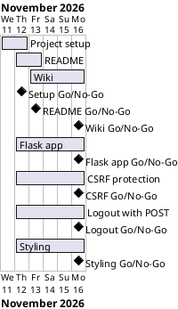

# Project Plan

## Metadata
| Key | Value |
| --- | --- |
| ID | PP-001 |
| CrossReference | [BC-001], [SA-001], [MIL-001], [MIL-002], [MIL-003], [MIL-004], [MIL-005], [MIL-006], [MIL-007] |
| Language | en |
| Domain | it |

## Version History
| Date | Status | Author | Reviewer | Change | Commit |
| --- | --- | --- | --- | --- | --- |
| 2026-11-11 | Accepted | Jens Tirsvad Nielsen | S01 | Add MIL-006 logout with POST<br>Reviewed in RC-020: Go | [1b75359] |
| 2026-11-11 | Accepted | Jens Tirsvad Nielsen | S01 | Add MIL-007 styling with Bootstrap<br>Reviewed in RC-024: Go | pending |

---

## Purpose

Schedule the three phases that turn the Day 68 lecture into a README, a three-language wiki and a working Flask application. The plan has no fixed deadline in the Business Case; it keeps a short, documentation-only schedule.

## Planning Assumptions

- The plan starts 2026-11-11 and ends by 2026-11-16, the duration constraint in [BC-001] (Constraints).
- Each phase is one branch and one pull request that closes its issues (source: the request of S01).
- S01 owns and reviews every phase; in autonomous mode the AI acts as stand-in reviewer and records it (source: AGENTS.md, Modes).

## Gateway Schedule

| Gateway | Document | Window | Decision date | Owner | Stories | Main deliverable | Milestone |
| --- | --- | --- | --- | --- | --- | --- | --- |
| Project setup | [MIL-001] | 2026-11-11 to 2026-11-12 | 2026-11-12 | S01 | none (documentation tasks) | Repository metadata and configuration | not yet synced |
| README | [MIL-002] | 2026-11-12 to 2026-11-13 | 2026-11-13 | S01 | none (documentation tasks) | README with step screenshots | not yet synced |
| Wiki | [MIL-003] | 2026-11-13 to 2026-11-16 | 2026-11-16 | S01 | none (documentation tasks) | Wiki in en, da, ms | not yet synced |
| Flask app | [MIL-004] | 2026-11-12 to 2026-11-16 | 2026-11-16 | S01 | none (technical tasks) | Flask application with tests | Milestone 4 (closed) |
| CSRF protection | [MIL-005] | 2026-11-12 to 2026-11-16 | 2026-11-16 | S01 | none (technical tasks) | CSRF tokens on the register and login forms | Milestone 5 (closed) |
| Logout with POST | [MIL-006] | 2026-11-12 to 2026-11-16 | 2026-11-16 | S01 | none (technical tasks) | POST-only logout with a CSRF-protected form | Milestone 6 (closed) |
| Styling | [MIL-007] | 2026-11-12 to 2026-11-16 | 2026-11-16 | S01 | none (technical tasks) | Bootstrap and own CSS on every page | not yet synced |



## Scope Coverage

| Business Case scope item | Gateway |
| --- | --- |
| Repository description and topics; `pyproject.toml`, `.gitignore`, `Doxyfile` | [MIL-001] |
| README, screenshots, `.venv` instructions | [MIL-002] |
| Wiki in three languages | [MIL-003] |
| Flask application and tests | [MIL-004] |
| CSRF protection of the forms | [MIL-005] |
| Logout as a protected POST | [MIL-006] |
| Styling of the pages | [MIL-007] |
| opengrep scan before push | All gateways |

## Dependencies

```
MIL-001 → MIL-002 → MIL-003
MIL-003 → MIL-004 → MIL-005 → MIL-006 → MIL-007
```

A No-Go on a gateway moves every later gateway by the rework time and may move the end date of 2026-11-16; S01 decides any move of the end date.

## Plan Risks

| Risk | Impact | Mitigation |
| --- | --- | --- |
| The signed course archive link has expired (BC-001 risk 1) | Screenshots are blocked | Stop and report per the autonomous stop rules; S01 supplies the archive |
| Docker image build for the end project fails | Screenshots delayed | Fix on the same branch; stop after three failed rounds |

## Open Issues

- The course archive link in the request carries an expiry; its validity is checked in MIL-002 task 1.

---

[BC-001]: ./business-case.md
[SA-001]: ./stakeholder-analysis.md
[MIL-001]: ./milestones/mil-001-project-setup.md
[MIL-002]: ./milestones/mil-002-readme.md
[MIL-003]: ./milestones/mil-003-wiki.md
[MIL-004]: ./milestones/mil-004-flask-app.md
[MIL-005]: ./milestones/mil-005-csrf-protection.md
[MIL-006]: ./milestones/mil-006-logout-post.md
[MIL-007]: ./milestones/mil-007-styling.md
[4a5ddde]: https://git.tirsystem.com/Tirsvad-Udemy-100-days-of-code/068-flask-auth/commit/4a5ddde2e1eacea3ee7b76655c4d51953e89c6fd
[a7d60a0]: https://git.tirsystem.com/Tirsvad-Udemy-100-days-of-code/068-flask-auth/commit/a7d60a0ff5f21fe76224c3663ba32f75a1af658e
[6ce33b0]: https://git.tirsystem.com/Tirsvad-Udemy-100-days-of-code/068-flask-auth/commit/6ce33b09098a294c1c7b93cb9f3e988bf72f60af
[1b75359]: https://git.tirsystem.com/Tirsvad-Udemy-100-days-of-code/068-flask-auth/commit/1b753595bc9d59fa84a8cc23dcb5e2a2ce4dfc47
